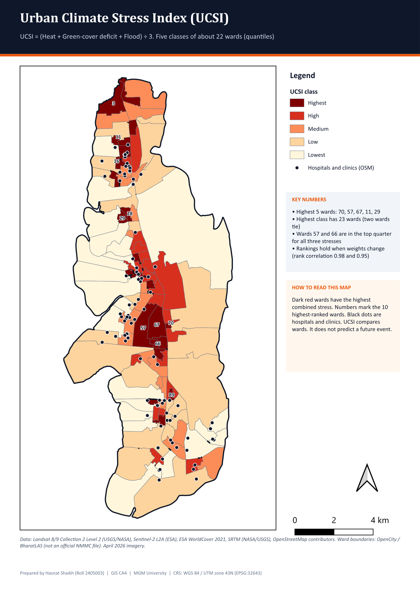
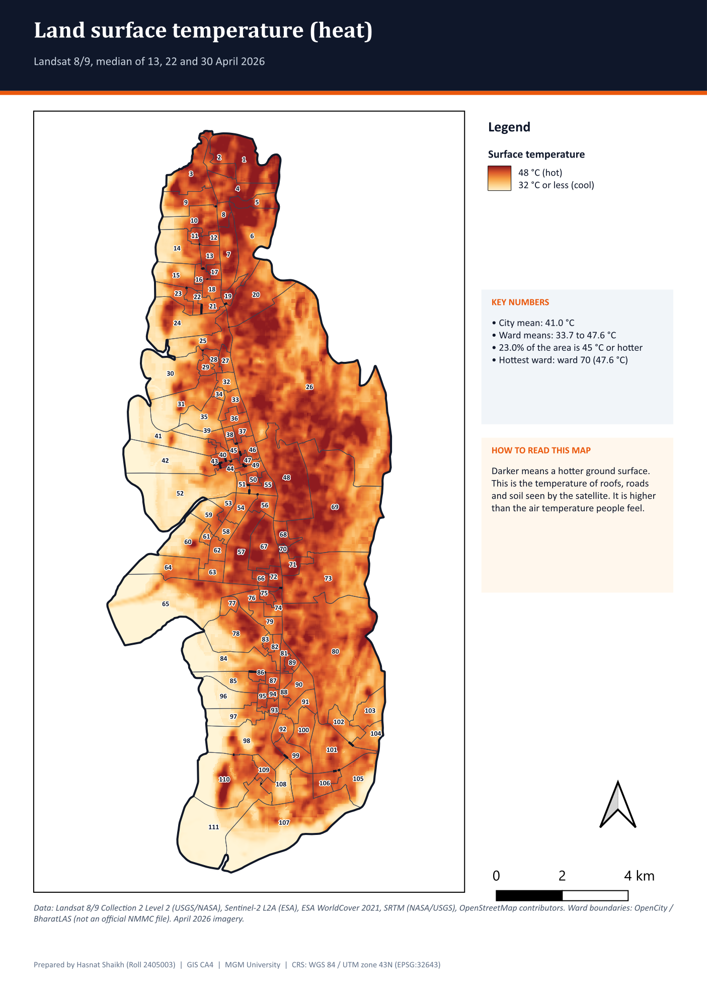
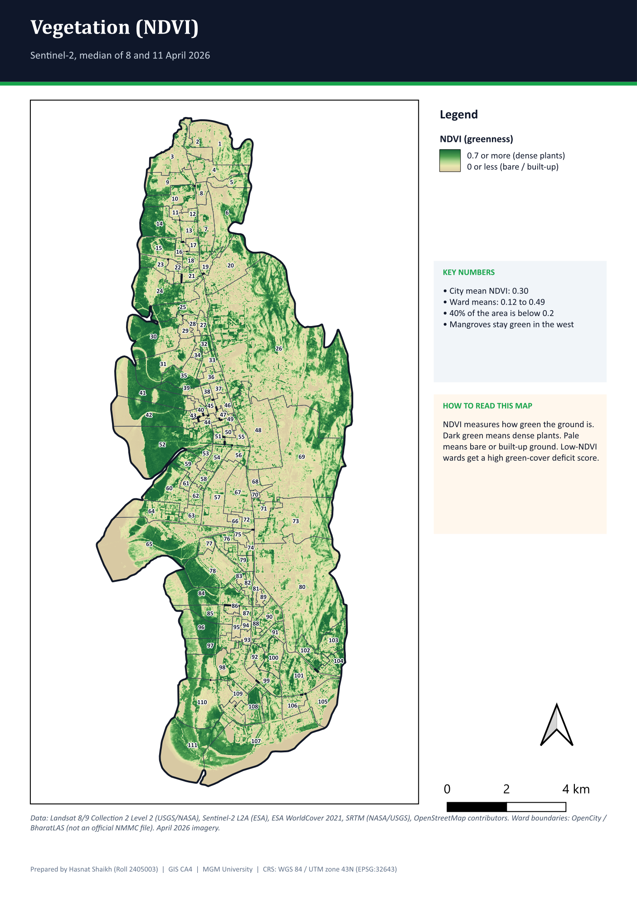
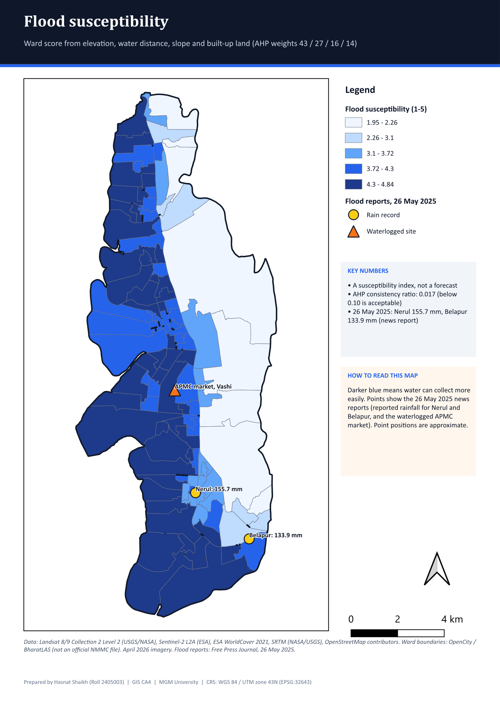
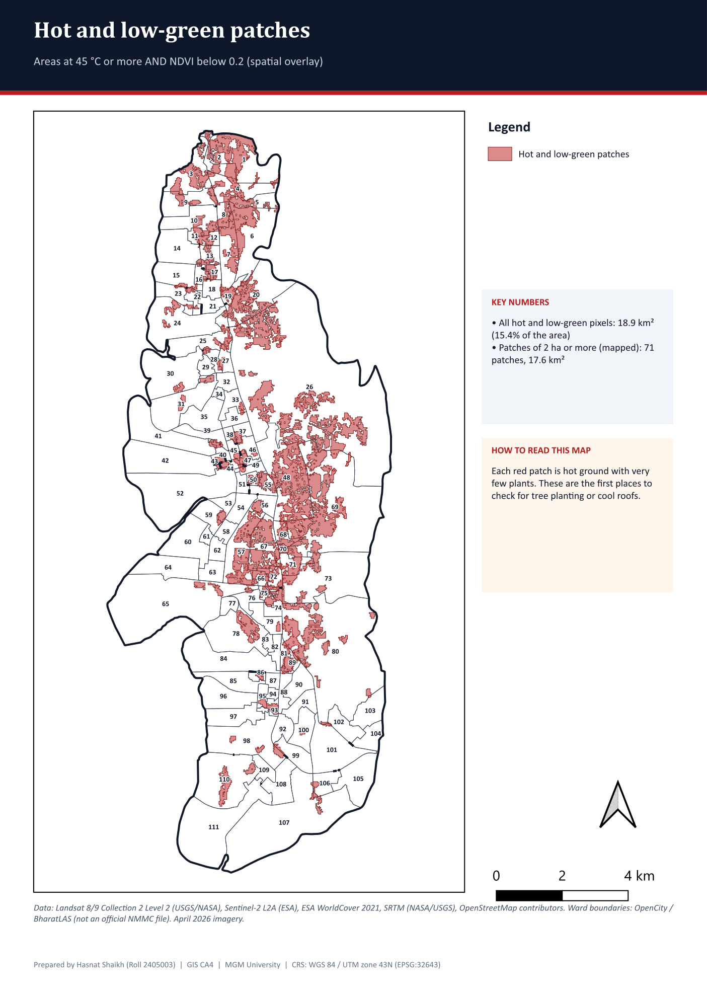

# Navi Mumbai Climate Stress Atlas (UCSI)

A ward-level **Urban Climate Stress Index (UCSI)** for the **111 wards of Navi Mumbai** (Maharashtra, India), built in QGIS from satellite data for April 2026. It combines three stresses, heat, lack of green cover and flood susceptibility, into one score per ward, and then asks which wards and hospitals are most exposed.

This is my GIS coursework project (MGM University, 5th semester).



## Headline results

| | |
|---|---|
| Study area | 111 wards |
| Average ward temperature (April 2026) | 42.4 °C land surface temperature |
| Average built-up share | 56% |
| Highest-stress wards | **70, 57, 67, 11, 29** (23 wards fall in the "Highest" class because two tie) |
| Hottest ward | Ward 70, about 47.6 °C |
| Hospitals inside the highest-stress wards | 8 of 93 mapped hospitals |
| Hot and low-green land | 17.6 km² in 71 patches, touching 85 wards |
| Robustness | Rankings stay similar when the weights change (rank correlation 0.98 and 0.95) |

## Method

| Component | Data | Score |
|---|---|---|
| **Heat** | Land surface temperature, Landsat 8/9 (April 2026) | 1–5 |
| **Green-cover deficit** | NDVI from Sentinel-2 (April 2026) | 1–5 |
| **Flood susceptibility** | Elevation and slope (SRTM), distance to water, built-up land (WorldCover 2021), AHP weights 43 / 27 / 16 / 14 | 1–5 |

**UCSI = (Heat + Green-cover deficit + Flood) ÷ 3**, then wards are ranked and split into five classes of about 22 wards each (quantiles).

Eleven queries were run on the result: 5 attribute queries (for example built-up ≥ 80%: 30 wards, surface temperature ≥ 45 °C: 23 wards) and 6 spatial queries (for example wards within 200 m of a major road: 78 wards, and the nearest hospital to each highest-stress ward: mean 693 m, longest 2.5 km). See `queries/Query_summary.csv`.

| Heat (LST) | Green cover (NDVI) |
|---|---|
|  |  |

| Flood susceptibility | Hot and low-green patches |
|---|---|
|  |  |

## Repository layout

```
project/NaviMumbai_UCSI.qgz      QGIS project (relative paths; open it from the repo root)
data/NaviMumbai_UCSI.gpkg        GeoPackage: wards (111), hospitals (93), roads, water bodies, hot/low-green zones, flood reports
data/NaviMumbai_query_results.gpkg   saved outputs of all queries
data/rasters/                    9 GeoTIFFs: LST, NDVI, land cover, built-up, elevation, slope, water distance, heat and green-deficit scores
maps/                            Map1 to Map10 (PNG); Map9 is the final UCSI map
queries/                         Query_A1..A5, S1..S6 (PNG) plus summary CSV and JSON
gee/                             5 Google Earth Engine scripts (LST, NDVI, built-up, terrain, ward statistics) with a README
scripts/                         Python and PyQGIS scripts used to build the data and the QGIS project
report/                          practical report (PDF) and all maps and queries in one PDF
```

The QGIS project was built and tested with QGIS 4.2, and QGIS 3.34 or newer should also open it. The CRS is WGS 84 / UTM zone 43N (EPSG:32643).

## Limits (please read)

- **The Earth Engine scripts in `gee/` have not been run.** The delivered rasters were made from the same public datasets and dates with Python (`rasterio`) outside Earth Engine. `gee/README.txt` lists the values to expect if you run them.
- **One season only** (April 2026). The flood score is a susceptibility index. It is not a forecast.
- Ward boundaries are public files (OpenCity / BharatLAS), not an official NMMC dataset. Roads and hospitals come from OpenStreetMap. Only three flood-report points were digitised by hand, from a news report, so their positions are approximate.
- UCSI compares wards with each other. It does not predict a future event.
- The `scripts/` contain file paths from the machine where I ran them.

## Tools
QGIS, PyQGIS, Python (rasterio, NumPy), Google Earth Engine, GeoPackage, OpenStreetMap (Overpass), Landsat 8/9, Sentinel-2, SRTM, ESA WorldCover.

## Author
Shaikh Mohammad Hasnat, [GitHub](https://github.com/Shaikh-Mohammad-Hasnat), [LinkedIn](https://www.linkedin.com/in/shaikh-mohammad-hasnat-698a08335)
